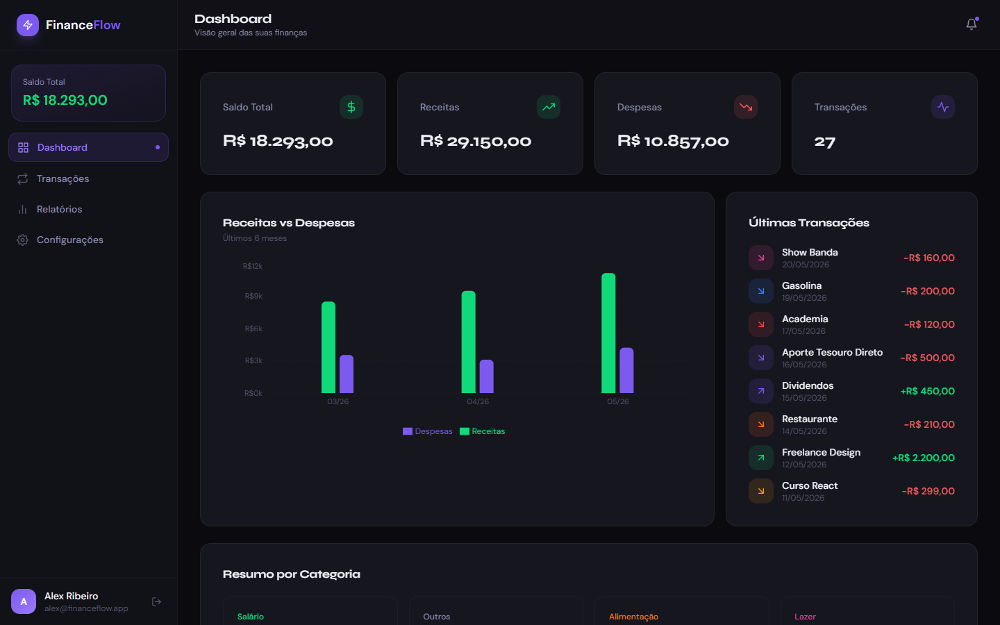
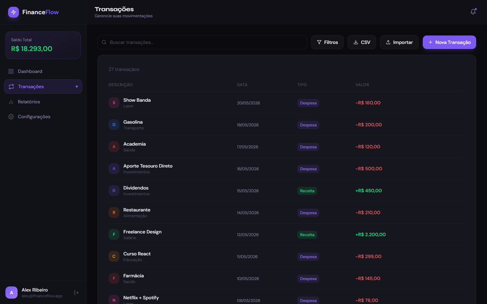
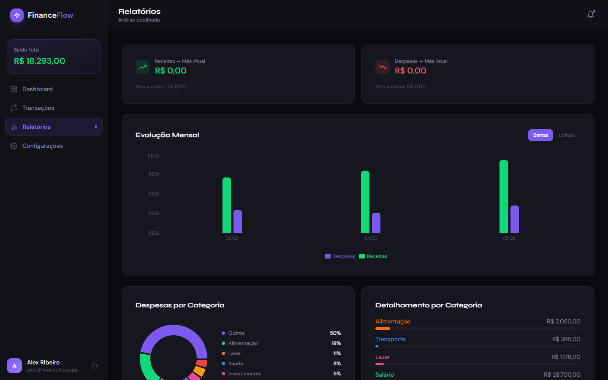
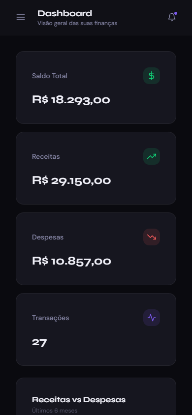

# FinanceFlow

Aplicação web de controle financeiro pessoal: registre receitas e despesas, importe extratos bancários e acompanhe para onde vai o seu dinheiro em gráficos e relatórios mensais.


**Demo:** [gerenciamento-financeiro-six.vercel.app](https://gerenciamento-financeiro-six.vercel.app)



## Por que existe

Planilhas de gastos são trabalhosas de manter e difíceis de analisar. O FinanceFlow centraliza as transações, permite importar o extrato do banco em vez de digitar tudo e mostra automaticamente saldo, evolução mensal e gastos por categoria.

## Funcionalidades

- **Dashboard:** saldo, receitas, despesas, gráfico dos últimos 6 meses e últimas transações.
- **Transações (CRUD):** criar, editar e excluir, com filtros por tipo, categoria, período e busca por texto, e paginação.
- **Importação de extratos OFX:** leitura do arquivo do banco (OFX 1.x e 2.x, Windows-1252 ou UTF-8), revisão de cada movimentação e categorização automática, sem duplicar transações já existentes.
- **Investimento, transferência e fatura:** na revisão, cada linha recebe um tipo — despesa, receita, investimento, resgate, transferência entre minhas contas ou pagamento de fatura. Investimentos ficam fora de receitas/despesas; transferências e faturas não entram, para o mesmo dinheiro não contar duas vezes. Correções viram regras aplicadas nos próximos extratos. Há um extrato de exemplo em `docs/extrato-exemplo.ofx`.
- **Relatórios:** gráficos de barras, linhas e pizza por categoria, e comparação do mês atual com o anterior.
- **Exportação para CSV.**
- **Autenticação simulada** com rotas protegidas (login de demonstração abaixo).
- **Persistência em LocalStorage:** os dados continuam lá depois de recarregar a página.
- **Layout responsivo** para desktop, tablet e celular.

| Transações | Relatórios | Mobile |
|---|---|---|
|  |  |  |

## Tecnologias

| | |
|---|---|
| Interface | React 19, Tailwind CSS 4, React Icons |
| Navegação | React Router 7 (rotas públicas e protegidas) |
| Estado global | Context API + hooks customizados |
| Gráficos | Recharts 3 |
| Datas | date-fns (pt-BR) |
| Utilitários | uuid, react-hot-toast, Axios (cliente HTTP já configurado para a API) |
| Build e qualidade | Vite 8, ESLint |

## Arquitetura

```
src/
├── components/   # Componentes de interface reutilizáveis (Button, Card, Modal, Table, Charts…)
├── context/      # AuthContext e FinanceContext: estado global e operações de CRUD
├── hooks/        # useFinance (filtros, paginação, dados dos gráficos) e useLocalStorage
├── pages/        # Dashboard, Transactions, Reports, Settings, Login, Register
├── routes/       # Definição das rotas e proteção por autenticação
├── layouts/      # MainLayout (Sidebar + Header + conteúdo)
├── services/     # Instância do Axios (para a versão com back-end)
├── utils/        # Funções puras: cálculos, formatação, parser de OFX
└── constants/    # Categorias e tipos de transação
```

As páginas orquestram dados e componentes, e os componentes só recebem props. A regra de negócio fica isolada em `context/`, `hooks/` e `utils/`, e as funções de `utils/` não têm efeitos colaterais.

## Como executar

Pré-requisito: **Node.js 20.19+** (exigido pelo Vite 8).

```bash
git clone https://github.com/EldenXLe/Gerenciamento-Financeiro.git
cd Gerenciamento-Financeiro
npm install
npm run dev
```

Acesse `http://localhost:5173`.

| Script | O que faz |
|---|---|
| `npm run dev` | Servidor de desenvolvimento |
| `npm run build` | Build de produção em `dist/` |
| `npm run preview` | Serve o build localmente |
| `npm run lint` | Análise estática com ESLint |
| `npm test` | Testes do leitor de OFX (node:test) |

**Login de demonstração:** `alex@financeflow.app` / `123456`. Também é possível criar uma conta na tela de cadastro; os dados ficam só no navegador.

### Variáveis de ambiente

A versão atual (branch `main`) não precisa de configuração. A variável abaixo só é usada pelo cliente HTTP, na integração com a API:

```bash
cp .env.example .env   # VITE_API_URL=http://localhost:3333
```

## Próximos passos

- Versão full stack em desenvolvimento na branch `feature/backend` (Node.js, Express, Prisma e PostgreSQL, com autenticação JWT). O código do back-end ainda não está publicado neste repositório.
- Testes automatizados com Vitest e Testing Library.

## Licença

[MIT](LICENSE) © Leandro Rodrigues
